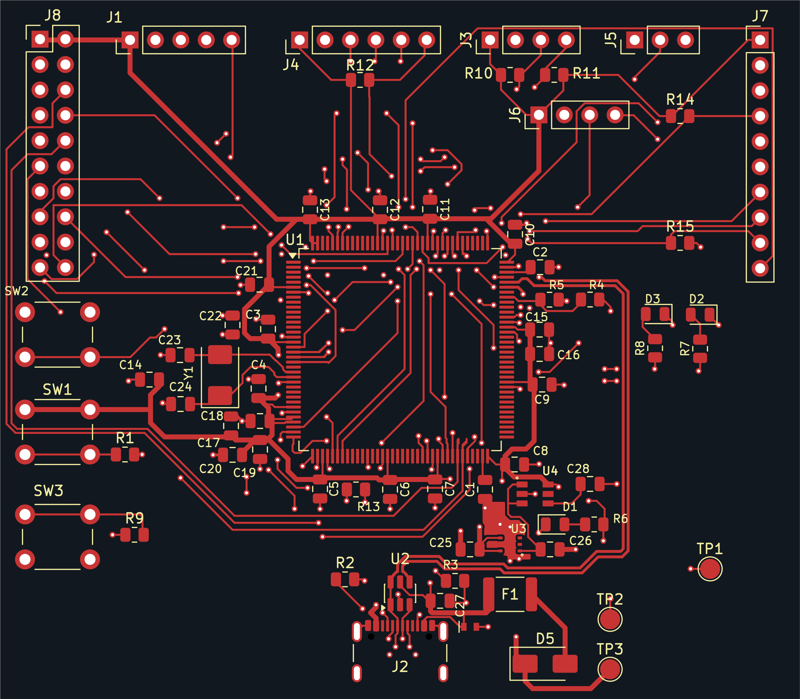
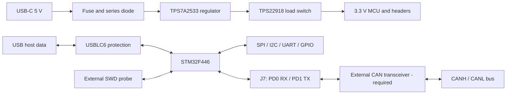

# STM32F446 Development Board

A custom, USB-powered development board for sensor and control experiments, built around the **STM32F446ZET6**. This project follows an embedded hardware design from component selection and PCB layout through assembly preparation, firmware and bench validation.

**Current milestone: first prototype preparation.** Hardware is not yet bench-tested. Exact fabrication stackup confirmation and final assembly production-file review remain open.

*Exported from the current KiCad design. Top copper and silkscreen only; this is a design view, not an assembled-board photograph.*

[Schematic PDF](docs/schematic.pdf) · [Design decisions](docs/design-decisions.md) · [Validation evidence](docs/validation.md) · [Part inventory](docs/components.json)

## What the board provides

| Area | Implementation |
|---|---|
| MCU | STM32F446ZET6, Arm Cortex-M4, LQFP-144 |
| PCB | 80 × 70 mm, four copper layers, nominal 1.6 mm |
| Power | USB 5 V → protection → TPS7A2533 regulator → TPS22918 load switch → 3.3 V |
| Connectivity | USB 2.0 full-speed device, SPI, I²C, UART, analog and GPIO headers |
| CAN expansion | Classical CAN 2.0B on J7: PD0/RX and PD1/TX; requires an external 3.3 V logic-compatible transceiver |
| Debug | External SWD probe through a custom five-pin header |
| Clock | 8 MHz crystal |
| User controls | Three pushbuttons and three indicator LEDs |

USB host operation, USB Power Delivery and motor-power delivery are outside the current scope. The load switch controls rail startup; it is not a programmable current limiter.

CAN uses the MCU's existing CAN1 controller through J7 pin 3 (PD0/CAN1_RX) and pin 4 (PD1/CAN1_TX), configured as AF9. The transceiver and bus termination are external to this PCB. This is Classical CAN, not CAN FD, and firmware/link testing is pending.

## Engineering work behind the layout

The work covers the power path, MCU support circuits, custom footprints, placement, routing and assembly data. Three examples make the iteration process concrete:

- **Reset routing:** moving C22 reduced its MCU reset route from **19.45 mm to 13.41 mm**, about 31%. The [before/after comparison](docs/design-decisions.md#reset-layout-iteration) records the improvement and remaining compromise.
- **Power margin:** a **250 mA total design budget** was screened against regulator dropout and dissipation. It remains conditional until load and thermal measurements establish the board's operating envelope.
- **Assembly data:** the supplier preview exposed header and chip rotation mismatches. Corrections were put into the placement file, uploaded and checked after a full quote reload.

Peer feedback and AI-assisted checks supported these iterations. Bench measurements will be reported separately from calculations and software checks.

## Evidence and next milestone

Recorded checks on **16 October 2026** report **0 active ERC issues, 0 DRC violations, 0 unconnected items and 0 schematic parity issues**. Seven previously reviewed ERC exclusions remain. [Validation evidence](docs/validation.md) links the reports and records known layout limits; these checks do not establish measured hardware performance.

Next: confirm the exact **JLC04161H-7628** stackup, approve final assembly placement and bring up the prototype. Power rails and current draw come first, followed by SWD/reset, clock startup, GPIO and USB. Every physical test in the [test log](docs/test-log.md) is currently marked **not tested**. Firmware will be added when implementation begins.

## Explore the design

Open [`stm32.kicad_pro`](stm32.kicad_pro) in **KiCad 10**, with its standard libraries installed.

| Files | Purpose |
|---|---|
| `stm32.kicad_sch`, `stm32.kicad_pcb` | Editable schematic and routed PCB |
| `stm32.kicad_dru` | Project design rules |
| `STM32_Custom.pretty`, `STM32_Power.kicad_sym` | Local footprints and symbols |
| `fp-lib-table`, `sym-lib-table` | Project-relative library configuration |
| `docs/` | Schematic export, design decisions, part inventory and validation evidence |

Local libraries are included. The empty `Library.pretty` directory is retained for the existing project library table. Final Gerbers and assembler placement files will accompany a reviewed manufacturing release after the open fabrication checks are closed. This repository is not a production release.

## References and licensing

[STM32F446 datasheet](https://www.st.com/resource/en/datasheet/stm32f446ze.pdf) · [TPS7A25 datasheet](https://www.ti.com/lit/ds/symlink/tps7a25.pdf) · [TPS22918 datasheet](https://www.ti.com/lit/ds/symlink/tps22918.pdf)

A project hardware/documentation license has not yet been selected. No explicit open-source license is currently granted. Third-party assets remain subject to their respective licenses.
