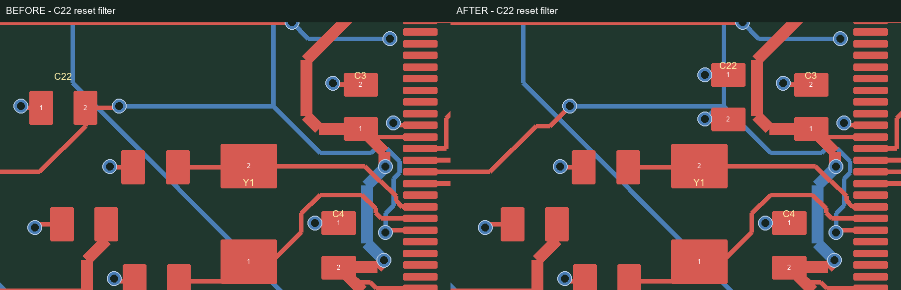

# Design decisions and iteration

This document records decisions visible in the current design and the evidence available for them. Planned tests are not presented as results.

## Power architecture and its trade-off

USB 5 V feeds a resettable fuse and series isolation diode, followed by a TPS7A2533 fixed 3.3 V LDO and a TPS22918 load switch. The MCU and expansion headers share the 3.3 V budget. High-current loads require an external power path.

The LDO avoids a switching power stage but turns voltage headroom into heat. A conservative screen, using connector voltage directly and ignoring beneficial fuse/diode drops, gives:

| Total 3.3 V load | Dissipation at 5.0 V input | Dissipation at 5.25 V input |
|---|---:|---:|
| 100 mA | 0.170 W | 0.195 W |
| 200 mA | 0.340 W | 0.390 W |
| 250 mA | 0.425 W | 0.488 W |

These use `P = (Vin − 3.3 V) × I`; they are calculations, not measurements. U3 has local ground spreading copper and four thermal ground vias. Actual board-level thermal resistance is not established, so 250 mA remains a conditional total design budget. Load-step and temperature measurements will determine whether further copper or placement changes are needed.

The switch timing capacitor controls rail turn-on. It does not enforce a current limit or negotiate USB current permission. The original switch-input bypass relied on U3's output capacitor through an approximately 11.43 mm supply path. The current revision adds C29, a dedicated 1 µF X7R 0603 capacitor beside U4's input, with a nearby GND via. C26 remains U3's output capacitor. Startup and transient measurements are still needed.

Requirements were checked against the [TI TPS7A25](https://www.ti.com/lit/ds/symlink/tps7a25.pdf) and [TPS22918](https://www.ti.com/lit/ds/symlink/tps22918.pdf) documentation.

## Four-layer routing and return paths

The intended stackup is JLC04161H-7628: nominal 1.6 mm, outer 1 oz and inner 0.5 oz copper. Both inner layers contain ground fills, with some low-speed signal crossovers on In2.Cu. They are not two wholly uninterrupted ground planes.

Return-path review identified a local ground-reference gap beneath SWDIO caused by a short PG9 inner-layer crossing. That crossing was moved to F.Cu and two obsolete PG9 transition vias removed; GND stitching was retained. The refilled ground now covers the checked SWDIO centreline outside excluded drilled neighbourhoods. See the [ground screen and its limits](engineering-review.md#ground-return-continuity-and-the-pg9-correction). Initial debug should still use short leads and a conservative clock. USB pad/via transitions and crystal startup remain validation items.

The quote initially specified no particular stackup. The fabricator subsequently confirmed the nominal JLC04161H-7628 construction. Its [layer dimensions and USB calculation limits](engineering-review.md#stackup-and-usb-geometry) are recorded separately; confirmation of nominal construction is not a measured impedance certificate.

## Reset layout iteration

Moving C22 closer to the MCU reduced the routed reset path from **19.45 mm to 13.41 mm**: **6.04 mm shorter, about 31%**. Its local ground connection was rebuilt and obsolete ground stubs removed.

*Historical comparison from the reset-layout revision. Red and blue represent front and back signal layers; this is not a scope measurement.*

The nearest pad-centre separation is still approximately 7.73 mm. A tighter result would require a broader rearrangement of neighbouring oscillator and power fanout components. The change improves the existing layout without claiming an ideal reset network. Reset behaviour still needs physical testing.

## Assembly orientation: checking persistence

The first preview showed headers crossing their hole rows and several chip pin-1 markers at the wrong corners. In-editor rotations appeared correct, but reopening the quote showed those adjustments had reverted.

The correction was moved into uploaded placement data: seven headers and U1/U2/U4 received supplier-specific rotation adjustments. The corrected files were processed and the quote fully reloaded. Each of those ten references was then visually checked again against holes or PCB pin-1 markings. After adding C29, the assembly inventory contains **66 intended fitted references**. J1 sourcing was updated to SHOU HAN SH-PZ254V-1x5P (C55629812) in both schematic and PCB.

The lesson was to validate saved manufacturing data after reopening, not just the current preview. KiCad footprint orientations were not changed to compensate for the supplier convention. Final assembler production-file approval remains a separate step.

## Schematic readability without changing the circuit

The original single-sheet schematic was reorganized into four functional sheets. The MCU symbol is split into supplies/control and ports A–G, while retaining the original package pin numbers and electrical pin types. Shared capacitor rails and connected divider, crystal and LED circuits make the signal flow easier to follow. Named signals carry connections between sheets.

For that historical refactor, all then-current 68 physical components retained their values, footprints, sourcing fields and original UUIDs. All 135 nets contained the same reference-and-pin pairs, and the physical PCB geometry was unchanged. The [comparison record](checks/schematic-refactor.json) records that revision's scope. Later C29 and routing changes are covered by the current [validation evidence](validation.md), rather than by this historical geometry comparison.

This improves reviewability; it does not add hardware test evidence or close the remaining fabrication and bring-up questions.

## Closing the remaining questions

1. Approve final fabrication and assembly production files against the corrected prototype package.
2. Inspect the assembled board and perform unpowered checks.
3. Record first-power voltages, current, startup and load-step behaviour.
4. Establish SWD/reset operation, then verify clock, GPIO and USB with versioned firmware.
5. Publish measurements and resulting design changes in the [test log](test-log.md).
