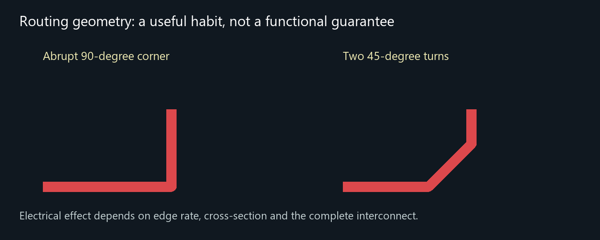

# Engineering review and layout corrections

Recorded 22 October 2026. This is a design review of an untested STM32F446 prototype. It separates rules, calculations, geometric screening and visual inspection from measurements on real hardware.

## Review method

The review followed the circuit from USB input through protection, regulation and the switched 3.3 V rail, then MCU supplies, reset, boot, clock, debug and external interfaces. Component requirements were compared with the saved schematic and routed board. Layout advice was interpreted in the context of actual geometry and signal edge rates, rather than treated as a list of universal pass/fail slogans.

| Review area | What was checked or corrected | Evidence and remaining limit |
|---|---|---|
| Connectivity | Supply nets, MCU pin mapping, headers, unused pins, schematic-to-PCB parity | Current ERC and DRC reports have zero issues; this checks the model and configured rules, not whether every design choice is correct |
| Power path | Fuse, series diode, LDO headroom, dissipation, switch startup and shared load budget | Conditional 250 mA total budget; voltage drop, startup and temperature still need measurement |
| Bypassing | MCU supply capacitors and local regulator/switch capacitors | C29 added at U4 input; transient performance remains unmeasured |
| Ground reference | Filled inner layers under USB, SWD and checked PG9 outer-layer segments | Local SWDIO gap corrected; sampled projection check is not a field solver |
| Routing geometry | Corners, width/spacing, layer changes and reference continuity | PF6 corner corrected; pad entries and branches are reported separately from ordinary bends |
| USB | Full-speed device topology, ESD, VBUS sensing and nominal differential geometry | Width/spacing calculation does not certify all escapes, pads, vias or assembled USB performance |
| Reset and clock | Reset capacitor route, crystal selection/loading and surrounding placement | Shorter reset route; crystal startup, drive and reset robustness need bench tests |
| Assembly | Exact part codes, package fit, header alignment, chip pin 1 and diode polarity | 66 assembly references, 31 selected part types; final production files still require approval |
| Exports | Gerber parsing, drill locations, archive contents and source hashes | Published package tied to the corrected saved board; not an independent fabricator acceptance certificate |

## Local input bypass at the load switch

The TPS22918 input originally depended on the regulator output capacitor C26 through an approximately 11.43 mm shared supply route. C29 now provides a dedicated **1 µF, 25 V, X7R, 0603** bypass from `VREG_3V3` to GND beside U4, with a nearby ground via. C26 remains the regulator output capacitor.

The selected C29 is Samsung **CL10B105KA8NNNC**, supplier code **C29936**. Its value, package and sourcing fields were synchronized between schematic, PCB and assembly inventory. Local bypassing provides a shorter path for transient input current; it does not establish that the complete power rail is stable under every load. The [TPS22918 datasheet](https://www.ti.com/lit/ds/symlink/tps22918.pdf) provides the component requirements.

## Ground return continuity and the PG9 correction

The important issue was a short In2.Cu PG9 crossing cutting local ground beneath a B.Cu SWDIO segment. Although SWDIO is connected to J1 elsewhere on the board, its return reference matters along the entire route, including this crossing.

The PG9 connection was rerouted around the neighbouring SPI pads on **F.Cu**, and the two now-unnecessary PG9 transition vias were removed. Ground stitching vias were retained. After zone refill, the local inner-layer ground filled back beneath SWDIO. PG9 still uses In2.Cu elsewhere; this change does not make both inner layers completely uninterrupted planes.

The [ground screen](checks/ground-screen.json) projects outer-layer track centrelines onto the adjacent inner GND fill at intervals no larger than 0.05 mm. It found zero missing samples for SWDIO (949 checked), SWCLK (756), USB D+ (1480), USB D- (1453), and the screened PG9 outer-layer sections (679). Drilled pad/via neighbourhoods are excluded and counted in the report. This supports closure of the identified geometric gap; it does not calculate return-current density, transition inductance, crosstalk or impedance.

## Routing corners: why prefer 45 degrees

An abrupt 90° corner adds local copper area and parasitic capacitance, producing an impedance discontinuity. Chamfered or curved routing makes the geometry change less abrupt and helps keep differential-pair spacing and length consistent. It also makes crowded routing easier to inspect. These are useful design habits, especially for fast edges and controlled-impedance interconnects.

*Illustration only. The diagram does not quantify this board's impedance or reflection amplitude.*

A right angle does **not** automatically produce a huge reflection or stop ordinary GPIO from working. Its effect depends on edge rise/fall time, trace cross-section, electrical length and surrounding discontinuities; clock frequency alone is insufficient. Choosing slow GPIO output slew where timing allows can also reduce unnecessary high-frequency content. No numerical reflection claim is made for this board without modelling or measurement.

[AMD's routing guidance](https://docs.amd.com/r/en-US/ug583-ultrascale-pcb-design/Microstrip/Stripline-Bends) discusses bend geometry and differential-pair skew. [Simberian's model-to-measurement study](https://www.simberian.com/AppNotes/Bends-AnalysisToMeasurements-2021-04-01.pdf) explains why narrow digital traces can show small bend effects while wider RF structures can be more sensitive. Those examples inform the design practice; their measured values are not measurements of this PCB.

The remaining ordinary right-angle bend identified on **PF6, F.Cu, near X = 138.6 mm / Y = 99.4 mm** was corrected. The [saved-board audit](checks/bend-audit.json) examined 1178 straight segments and found **zero ordinary track-to-track 90° bends** within 1° tolerance, joining endpoints rounded to 1 µm on the same net and layer. It separately classifies 23 pad connections, four via connections and two branch junctions. This is not a claim that every copper polygon, footprint pad or junction has no square corner, nor that the board is signal-integrity certified.

Return-path continuity, clean power, proper terminations where needed and appropriate driver slew remain more important than making a board look uniformly diagonal. The corner cleanup was followed by saved-source, connectivity, refill and export checks.

## Stackup and USB geometry

The fabricator confirmed the nominal JLC04161H-7628 construction used in the design:

| Layer or dielectric | Nominal thickness |
|---|---:|
| F.Cu | 0.035 mm |
| Prepreg | 0.2104 mm |
| In1.Cu | 0.0152 mm |
| Core | 1.065 mm |
| In2.Cu | 0.0152 mm |
| Prepreg | 0.2104 mm |
| B.Cu | 0.035 mm |

These are nominal construction inputs, not measurements of a fabricated lot. Both inner layers carry GND fills; In2.Cu also contains signal crossovers. F.Cu primarily references In1.Cu and B.Cu references In2.Cu.

The main USB pair uses approximately **0.290576 mm width and 0.2032 mm gap**, selected from a nominal 90 Ω differential calculation for the outer-layer construction. Short 0.2 mm escapes and layer transitions remain. The pair has unequal via counts (D+: two; D-: four), so a nominal straight-section calculation cannot certify the entire channel. A calculator's numerical convergence tolerance is not a manufacturing impedance guarantee.

The board targets **USB full-speed device operation, 12 Mbit/s**. VBUS sensing uses the reviewed 33 kΩ / 82 kΩ divider into PA9. Firmware must implement the corresponding input configuration and disable the dedicated VBUS sensing arrangement where required by ST's divider method. USB protection and layout were reviewed against [ST AN4879](https://www.st.com/resource/en/application_note/an4879-introduction-to-usb-hardware-and-pcb-guidelines-using-stm32-mcus-stmicroelectronics.pdf). Enumeration, repeated transfers and power-cycle behaviour remain untested.

## Power, reset, crystal and expansion

The [design decisions](design-decisions.md) record LDO dissipation and the reset-placement iteration. The TPS7A25 device rating must not be mistaken for a proven board current rating. The 250 mA figure is a conditional **total** MCU-plus-expansion budget, subject to input headroom, USB power constraints, ambient temperature and measured cooling. The TPS22918 is a load switch, not a programmable current limiter. See the [regulator datasheet](https://www.ti.com/lit/ds/symlink/tps7a25.pdf).

The 8 MHz crystal has 18 pF specified load capacitance and 22 pF board load capacitors. The effective load also includes board and pin parasitics; nominal capacitor values alone do not prove startup margin or acceptable crystal drive. Reset routing improved but remains less compact than ideal. Both require physical validation against the [STM32F446 datasheet](https://www.st.com/resource/en/datasheet/stm32f446ze.pdf) and applicable errata.

J1 is a custom five-pin SWD header, not a standard 10-pin Cortex connector: **1 = +3V3 reference, 2 = SWDIO, 3 = GND, 4 = SWCLK, 5 = NRST**. Probe adapter wiring must follow that map. J7 exposes Classical CAN controller pins but requires an external compatible transceiver and termination. Motor drivers, industrial-voltage I/O, isolation, EMC compliance and functional safety are outside this prototype's demonstrated capability.

## Sourcing and assembly review

J1 was changed to **SHOU HAN SH-PZ254V-1x5P, C55629812**, a five-pin 2.54 mm through-hole header. A missing supplier preview model was distinguished from a missing physical part; the actual part was selected in the assembly list. Availability at a later build must be rechecked.

The current BOM/CPL covers **66 fitted references across 31 part types**. Three PCB test points bring the physical-reference count to 69. Seven header centroids and supplier-specific rotations for the headers and U1/U2/U4 were checked against the assembly preview. Chip pin-1 markers and D1-D5 polarity were visually compared with board markings. Corrections were verified after reopening the quote, rather than relying only on the editor's temporary display.

These preview checks are not approval of final production files or proof of assembly yield. The published CPL encodes the supplier convention used in this review; another assembly service must verify it independently. Fabricator manufacturing review also does not replace circuit design review, USB impedance verification or functional testing.

## Evidence and next steps

The [validation manifest](checks/manifest.json) ties current checks to source hashes. The [prototype package](../manufacturing/prototype-r3/) publishes the corresponding exports without private order details. The historical schematic-refactor comparison and reset before/after illustration are retained as dated history, rather than presented as checks of every subsequent change.

Next steps are final production-file review, inspection of assembled boards, controlled first power, SWD/reset, clock, GPIO and USB tests. Use the [bring-up checklist](bring-up.md) and record measurements in the [test log](test-log.md). No board functionality, thermal qualification, EMC result or industrial suitability is claimed before those tests.
